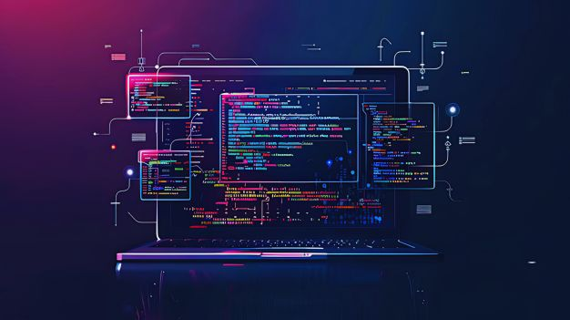

 <!-- Hero Developer Background -->

  

<h1 align="center">Hi, I'm Rediet Tadesse 👋</h1>

<h3 align="center">
  Software Engineer • Backend & DevOps • System Architecture
</h3>

  

---

## 👨‍💻 About Me

I'm a Software Engineer and a recent Software Engineering graduate from **Bahir Dar University**, with a strong focus on **backend development, system architecture, and DevOps**.

I've contributed to real-world software projects involving enterprise systems, financial applications, web platforms, and mobile applications. I enjoy designing maintainable backend systems, building APIs and microservices, and exploring how software can be delivered reliably through automation and containerization.

I'm particularly interested in **Clean Architecture, Hexagonal Architecture, Domain-Driven Design (DDD), distributed systems, and scalable software infrastructure**.

---

## 🧭 What I'm Focused On Right Now

- ⚙️ Building backend services with **Spring Boot and Go**
- 🏗️ Designing maintainable systems using **Clean Architecture, Hexagonal Architecture, and DDD**
- 🔗 Developing microservices and service-to-service communication with **gRPC**
- 🐳 Working with **Docker, CI/CD, GitHub Actions, and Kubernetes**
- 🔐 Building secure, reliable, and well-structured backend systems
- ☁️ Strengthening my knowledge of **DevOps and deployment practices**

---

## 🛠 Tech Stack

| Frontend | Backend | Database | Mobile |
|---|---|---|---|
|   |     |   |  |

### ⚙️ DevOps & Development Tools

  

- **DevOps:** Docker, Kubernetes, GitHub Actions, CI/CD, containerization
- **API Tools:** Swagger/OpenAPI, Postman
- **Version Control:** Git, GitHub

### 🧠 Architecture & Engineering Practices

- Clean Architecture
- Hexagonal Architecture (Ports & Adapters)
- Domain-Driven Design (DDD)
- Microservices Architecture
- System Design
- Performance Optimization
- Separation of Concerns and Maintainable Code

---

## 🚀 Featured Work

### 🏦 Core Banking System — Qershi Link
- Designed a **schema-per-tenant** approach for database isolation.
- Structured backend services using **Hexagonal Architecture**.
- Developed microservices communicating through **gRPC**.
- Used Docker and explored Kubernetes deployments with service-specific manifests and namespaces.

### 🧩 IIMS — Innovation & Incubation Management System
- Contributed to a subscription-based, multi-tenant SaaS platform for innovation workflows.
- Worked on backend architecture, database design, and application development.
- Used **Docker and GitHub Actions** to support CI/CD and delivery.

### 🏢 BDA ERP & GATO ERP
- Contributed to enterprise systems with modules for user management, work orders, customers, contracts, finance, inventory, and sales.
- Worked across backend development, frontend integration, and deployment-related tasks.

### ♻️ GreenLoop
- Contributed to a recycling platform combining mobile development and AI-assisted object categorization.
- Worked with **Flutter, Supabase, and Clean Architecture**.

### 🌐 Web Platforms
- Built and contributed to production websites for multiple organizations.
- Worked with **React and Supabase**, including admin dashboards and SEO-focused implementation.

---

## 🏆 Achievements

- 🥈 **2nd Place** — Cursor Hackathon, Bahir Dar
- 🏅 **Top 10 Nationally** — Bruh Ethiopia ICT Innovation Challenge
- 🥇 **1st Place** — WomenTechMark
- 🎓 **Mentor** — BiTec Hackathon Challenge
- 🌱 **Top-Performing Project, Ethiopia Round** — Hult Prize, GreenLoop
- 🥉 **3rd Place** — Bahir Dar University Final Year Project & Production System, IIMS

---

## 📊 GitHub Insights

  
  
  

---

## 📫 Let's Connect

  
  
  

---

  <i>"Good software is not just about making things work — it's about designing systems that work well and stand the test of time."</i>

